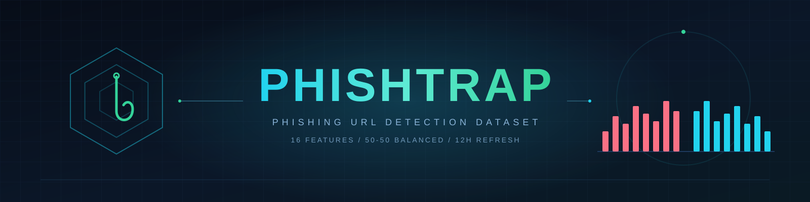

# PhishTrap

A curated, reproducible dataset for phishing URL detection. Every URL is either a confirmed phishing domain from a verified threat feed or a top-ranked legitimate site from Tranco. Each row is described by 16 features computed from the URL string alone, so models trained here need no page fetches, DNS lookups, or third-party APIs at inference time.

The dataset is rebuilt from live feeds once a day by a fully open-source pipeline hosted at [github.com/instax-dutta/PhishTrap](https://github.com/instax-dutta/PhishTrap).

Last dataset refresh: 2026-11-20T15:58:40Z

## Why this dataset exists

Most phishing datasets share the same problems: labels scraped from a single unverified list, train and test sets that overlap, features that require network calls at prediction time, and no way to tell how old a record is. PhishTrap is built around the opposite priorities, in this order: **quality, ease of access, quantity**.

- **Cross-verified labels.** A phishing URL must appear in at least one reputable, actively maintained feed. Legitimate URLs come from the top 10,000 sites in Tranco, which aggregates CrUX, Cloudflare, Umbrella, and Majestic rankings.
- **No leakage.** Canonical deduplication and a deterministic stratified split keep the same site out of multiple splits.
- **Self-contained features.** All 16 features are derived from URL text, so the dataset transfers cleanly to a production classifier.
- **Inspectable freshness.** Every row carries `first_seen`, `last_seen`, and `collected_at`, so consumers can filter by recency instead of trusting a single build date.
- **Reproducible.** The build pipeline is open source and deterministic; the same inputs produce the same dataset.

## Dataset at a glance

| | |
|---|---|
| Size | About 19,950 URLs, split evenly between classes |
| Features | 16 numerical URL-structure features |
| Splits | 70% train / 15% validation / 15% test |
| Formats | CSV and Parquet |
| Label | `0` legitimate, `1` phishing |
| License | MIT |

## Features

All features come from the URL string. The first six describe basic structure; the remaining ten capture deeper signals commonly associated with obfuscation.

| Feature | Meaning |
|---|---|
| `url_length` | Total character count of the URL |
| `hyphen_count` | Number of hyphens |
| `digit_count` | Number of digits |
| `subdomain_count` | Subdomains below the registered domain |
| `trusted_tld` | `1` for `.com`, `.org`, `.net`, `.edu`, `.gov`, `.mil`, `.int` |
| `protocol_exists` | `1` when the URL includes `http://` or `https://` |
| `special_char_count` | Count of characters such as `@`, `-`, `_`, `.`, `?` |
| `entropy` | Shannon entropy of the URL string |
| `path_depth` | Number of path segments |
| `domain_length` | Length of the hostname |
| `is_domain_ip` | `1` when the hostname is a literal IPv4 address |
| `has_at_symbol` | `1` when `@` appears in the URL |
| `has_double_slash_redirect` | `1` when `//` appears after the scheme |
| `tld_length` | Length of the top-level domain |
| `query_param_count` | Number of query parameters |
| `path_length` | Length of the path component |

## Data sources and provenance

Phishing candidates come from three feeds: [Phishing.Database](https://www.phishingdatabase.net/), [OpenPhish](https://openphish.com/), and [PhishStats](https://phishstats.info/). The first is PyFunceble-tested daily, OpenPhish refreshes every 15 minutes, and PhishStats contributes additional recent URLs. A URL only needs to appear in one feed to be included, and the `source` column records every feed that reported it, for example `openphish+phishing_database`.

Legitimate URLs come from the Tranco top 10,000 list. That set is filtered against known phishing domains before inclusion, so a compromised or misclassified site cannot land in the negative class.

Every row also records when it was first and last observed. If a Tranco domain later appears in a phishing feed, the phishing label wins and the conflict is logged. Phishing URLs left unconfirmed for 60 days are pruned; legitimate domains never expire because the Tranco top 10,000 is stable by design.

## Using the dataset

With Hugging Face Datasets:

```python
from datasets import load_dataset
from sklearn.ensemble import RandomForestClassifier

ds = load_dataset("saidutta69/PhishTrap")
features = [c for c in ds["train"].column_names
            if c not in ("url", "label", "source")]

clf = RandomForestClassifier(n_estimators=100, random_state=42)
clf.fit(ds["train"][features], ds["train"]["label"])
print(f"Test accuracy: {clf.score(ds['test'][features], ds['test']['label']):.4f}")
```

With pandas:

```python
import pandas as pd

df = pd.read_csv("hf://datasets/saidutta69/PhishTrap/data/phishtrap_full.csv")
```

## How updates work

A GitHub Actions workflow runs once a day and moves the data through these stages in order:

```
fetch live feeds -> merge with existing data -> prune stale evidence
    -> rebalance to 50/50 -> stratified split -> upload -> verify
```

Each stage is defensive. Failed fetches retry with exponential backoff and fall back to mirror hosts; a source that is entirely unavailable is skipped rather than allowed to empty the dataset. Merging uses a canonical URL key that ignores scheme, default port, and trailing slash, so the same site reported in different formats collapses to one row. Before anything is published, every split is checked for missing features, non-finite values, duplicate URLs, and class balance. After upload, the published files are downloaded and validated again.

The result is a dataset that keeps itself current while staying auditable at every step.

## Running the pipeline yourself

```bash
pip install -r requirements.txt
export HF_TOKEN=hf_...        # needed to upload; not needed for --dry-run

python run_pipeline.py --dry-run               # fetch, merge, rebalance, no upload
python run_pipeline.py                          # incremental refresh
python run_pipeline.py --force-full             # rebuild from scratch
python run_pipeline.py --max-samples 20000      # larger balanced dataset
```

The workflow lives in [`.github/workflows/refresh-phishtrap.yml`](https://github.com/instax-dutta/PhishTrap/blob/main/.github/workflows/refresh-phishtrap.yml) and the implementation in [`phishtrap_pipeline/`](https://github.com/instax-dutta/PhishTrap/tree/main/phishtrap_pipeline). Repo-level contracts and work guidance are in the `AGENTS.md` DOX tree.

The original single-file builder, [`build_phishtrap.py`](https://github.com/instax-dutta/PhishTrap/blob/main/build_phishtrap.py), is kept for reference, but the package-based pipeline above is the supported path.

## Citation

```bibtex
@misc{dash2026phishtrap,
  author = {Dash, Sai Dutta Abhishek and Sadangi, Jyotirmayi and
            Pradhan, Jatin Kumar and Sahoo, Bidush Kumar and Kumar, Raghvendra},
  title = {PhishTrap: High-Quality Phishing URL Dataset},
  year = {2026},
  publisher = {Hugging Face},
  howpublished = {\url{https://huggingface.co/datasets/saidutta69/PhishTrap}}
}
```

## License

MIT. Built with Phishing.Database, OpenPhish, PhishStats, and Tranco.
